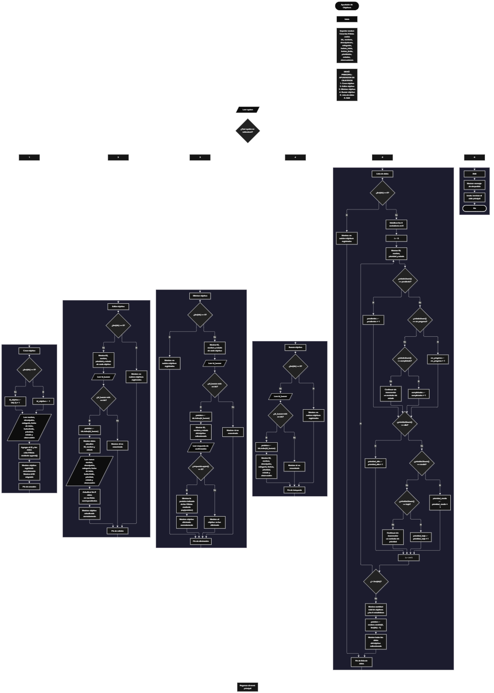

Este proyecto, llamado <b>apuntador de objetivos</b>, fue desarrollado en <b>python</b> como un ejercicio práctico para fortalecer la lógica de programación mediante la creación de un sistema de gestión de objetivos desde la consola. El programa cuenta con un menú principal de seis opciones que permite <b>crear, editar, eliminar, buscar y listar objetivos, además de salir del sistema</b>. Cada objetivo almacena información como el nombre, la descripción, la categoría, la fecha de inicio, la fecha límite, la prioridad, el estado y las observaciones. Los datos se organizan mediante nueve listas relacionadas que mantienen la información de cada objetivo durante la ejecución del programa. Durante su desarrollo se aplicaron conceptos fundamentales de programación, como variables, listas, estructuras condicionales, ciclos repetitivos, búsqueda de registros, modificación y eliminación de datos, así como el uso de contadores y selección aleatoria de elementos. Este proyecto permite poner en práctica los conocimientos adquiridos en python y sirve como base para desarrollar sistemas de gestión más avanzados.

<h2 align="center">⚙️ Funcionamiento del menú principal</h2>

### ➕ Crear objetivo

La opción <b>1) crear objetivo</b> permite registrar un nuevo objetivo en el sistema. Antes de almacenar los datos, el programa comprueba si la lista <b>ids</b> está vacía. Si no existen objetivos registrados, asigna el identificador <b>1</b> al nuevo objetivo. Si ya existen registros, genera el identificador sumando uno al último valor almacenado en la lista <b>ids</b>, mediante la expresión <b>ids[-1] + 1</b>. Después, solicita el <b>nombre, descripción, categoría, fecha de inicio, fecha límite, prioridad, estado y observaciones</b>. Los valores introducidos se agregan a sus respectivas listas mediante el método <b>append()</b>, conservando la correspondencia entre los datos de cada objetivo. Finalmente, muestra el mensaje <b>"objetivo registrado correctamente."</b> e informa el identificador asignado. Esta operación no establece una capacidad máxima para la cantidad de objetivos registrados.

### ✏️ Editar objetivo

La opción <b>2) editar objetivo</b> permite modificar la información de un objetivo registrado. Primero, el programa comprueba si existen objetivos mediante la lista <b>ids</b>. Si no hay registros, muestra el mensaje <b>"no existen objetivos registrados."</b>. En caso contrario, presenta una lista con el identificador, el nombre, la prioridad y el estado de cada objetivo. Después, solicita el identificador del objetivo que se desea editar y comprueba si se encuentra en la lista <b>ids</b>. Si existe, utiliza el método <b>index()</b> para obtener la posición correspondiente y muestra el identificador, el nombre y el estado actuales. A continuación, solicita los nuevos valores del nombre, la descripción, la categoría, la fecha de inicio, la fecha límite, la prioridad, el estado y las observaciones, actualizando directamente las listas correspondientes. Finalmente, presenta el mensaje <b>"objetivo actualizado correctamente."</b>. Si el identificador introducido no se encuentra registrado, muestra el mensaje <b>"id no encontrada."</b>.

### 🗑️ Eliminar objetivo

La opción <b>3) eliminar objetivo</b> permite eliminar un objetivo registrado mediante su identificador. Primero, el programa comprueba si existen objetivos almacenados. Si las listas no contienen registros, muestra el mensaje <b>"no existen objetivos registrados."</b>. Si hay objetivos disponibles, presenta una lista con el identificador, el nombre y el estado de cada uno. Después, solicita el identificador del objetivo que se desea eliminar y comprueba si está presente en la lista <b>ids</b>. Si lo encuentra, obtiene su posición mediante el método <b>index()</b>, muestra el identificador, el nombre y el estado del objetivo, y solicita confirmación mediante la pregunta <b>"¿desea eliminar este objetivo? (s/n): "</b>. Si la respuesta convertida a mayúscula mediante <b>upper()</b> es igual a <b>"S"</b>, elimina los datos de esa posición en las nueve listas utilizando el método <b>pop()</b> y muestra el mensaje <b>"objetivo eliminado correctamente."</b>. Si la respuesta es diferente de <b>"S"</b>, muestra el mensaje <b>"el objetivo no fue eliminado."</b>. Si el identificador no existe, presenta el mensaje <b>"id no encontrada."</b>.

### 🔎 Buscar objetivo

La opción <b>4) buscar objetivo</b> permite localizar un objetivo mediante su identificador. Primero, el programa comprueba si existen objetivos registrados. Si las listas están vacías, muestra el mensaje <b>"no existen objetivos registrados."</b>. En caso contrario, solicita el identificador del objetivo que se desea buscar y verifica si está presente en la lista <b>ids</b>. Cuando encuentra una coincidencia, utiliza el método <b>index()</b> para obtener la posición del registro y mostrar su información completa: <b>identificador, nombre, descripción, categoría, fecha de inicio, fecha límite, prioridad, estado y observaciones</b>. Si el identificador introducido no corresponde a ningún objetivo registrado, muestra el mensaje <b>"id no encontrada."</b>. Esta función permite consultar los datos de un objetivo específico sin necesidad de recorrer visualmente todos los registros.

### 📋 Lista de datos

La opción <b>5) lista de datos</b> permite visualizar los objetivos registrados y consultar estadísticas relacionadas con su estado y prioridad. Primero, el programa comprueba si existen objetivos almacenados. Si las listas están vacías, muestra el mensaje <b>"no existen objetivos registrados."</b>. Si hay registros, inicializa seis contadores: <b>pendientes, en_progreso, completados, prioridad_alta, prioridad_media y prioridad_baja</b>. Después, utiliza un ciclo <b>for</b> para recorrer las posiciones de las listas, mostrando el identificador, el nombre, la prioridad y el estado de cada objetivo. Durante el recorrido, compara los estados y las prioridades utilizando el método <b>lower()</b> para contabilizar los valores reconocidos por el programa. Al finalizar, muestra el total de objetivos registrados y las cantidades correspondientes a cada estado y prioridad. Finalmente, utiliza <b>random.randint(0, len(ids) - 1)</b> para seleccionar aleatoriamente uno de los objetivos almacenados y presentar todos sus datos. De esta manera, la opción reúne el listado general, las estadísticas y la consulta aleatoria de un objetivo.

### 🚪 Salir del menú principal

La opción <b>6) salir</b> permite finalizar la ejecución del programa. Cuando el usuario selecciona esta opción, el sistema muestra el mensaje <b>"gracias por utilizar el apuntador de objetivos."</b> y ejecuta la instrucción <b>break</b> para interrumpir el ciclo <b>while True</b>. De esta manera, el programa termina el menú principal y finaliza su ejecución. Los objetivos se almacenan únicamente en las listas que permanecen en memoria durante la ejecución, por lo que los registros no se conservan automáticamente cuando el programa termina.

<h2 align="center">🧠 Temas aplicados en el proyecto</h2>

### 📦 Variables

En este proyecto se utilizan variables para controlar la opción seleccionada en el menú, generar identificadores, localizar objetivos, almacenar temporalmente los datos introducidos por el usuario, identificar la posición de cada registro y realizar las estadísticas. También se utilizan variables para gestionar la confirmación de eliminación y seleccionar aleatoriamente un objetivo. Cada variable cumple una función específica dentro de las operaciones de gestión.

🔢 **Opcion:** Almacena la opción seleccionada por el usuario en el menú principal.

🆔 **Id_objetivo:** Representa el identificador que se asigna al registrar un objetivo nuevo.

🔎 **Id_buscar:** Almacena el identificador introducido para localizar un objetivo.

📍 **Posicion:** Permite identificar el índice correspondiente al objetivo que se desea consultar, editar o eliminar, y seleccionar un objetivo aleatorio.

🔄 **I:** Funciona como contador para recorrer las posiciones de las listas y calcular las estadísticas.

📝 **Nombre, descripcion y categoria:** Almacenan los datos descriptivos del objetivo.

📅 **Fecha_inicio y fecha_limite:** Almacenan las fechas relacionadas con el objetivo.

🎯 **Prioridad y estado:** Almacenan el nivel de prioridad y la situación actual del objetivo.

📋 **Observacion:** Almacena las observaciones asociadas al objetivo.

🔐 **Respuesta:** Almacena la respuesta introducida por el usuario para confirmar o cancelar la eliminación.

📊 **Pendientes, en_progreso y completados:** Son contadores utilizados para calcular la cantidad de objetivos según su estado.

⚡ **Prioridad_alta, prioridad_media y prioridad_baja:** Son contadores utilizados para calcular la cantidad de objetivos según su prioridad.

### 🗃️ Listas

En este proyecto se utilizan nueve listas relacionadas para almacenar la información de los objetivos. Cada lista conserva un tipo de dato correspondiente a los registros y utiliza el mismo índice para representar los datos de un mismo objetivo. Por ejemplo, la información del objetivo ubicado en la posición <b>0</b> se encuentra distribuida entre <b>ids[0], nombres[0], descripciones[0], categorias[0], fechas_inicio[0], fechas_limite[0], prioridades[0], estados[0] y observaciones[0]</b>. Esta organización permite recorrer, buscar, modificar, mostrar y eliminar los registros de manera coordinada.

🆔 **Ids:** Almacena los identificadores de los objetivos registrados.

📝 **Nombres:** Almacena los nombres de los objetivos.

📄 **Descripciones:** Almacena las descripciones de los objetivos.

🗂️ **Categorias:** Almacena las categorías asignadas a los objetivos.

📅 **Fechas_inicio:** Almacena las fechas de inicio de los objetivos.

⏳ **Fechas_limite:** Almacena las fechas límite establecidas para los objetivos.

🎯 **Prioridades:** Almacena las prioridades de los objetivos.

📊 **Estados:** Almacena los estados de los objetivos.

📋 **Observaciones:** Almacena las observaciones relacionadas con cada objetivo.

### 🔀 Estructuras condicionales

En este proyecto se utilizan estructuras condicionales <b>if, elif y else</b> para controlar las operaciones del menú y determinar las acciones que debe ejecutar el programa. Estas estructuras permiten comprobar si existen objetivos registrados antes de realizar determinadas operaciones, verificar si un identificador se encuentra en la lista <b>ids</b>, decidir si se deben actualizar los datos y determinar si se confirma la eliminación de un objetivo. También se utilizan para comparar los estados y las prioridades durante el cálculo de las estadísticas. De esta manera, el programa responde de acuerdo con la información almacenada y las decisiones introducidas por el usuario.

### 🔄 Estructuras repetitivas

En este proyecto se utilizan los ciclos <b>while</b> y <b>for</b>. El ciclo <b>while True</b> mantiene activo el menú principal y permite ejecutar repetidamente las operaciones disponibles hasta que se selecciona la opción de salida, que utiliza <b>break</b> para finalizar el ciclo. Por otro lado, los ciclos <b>for</b> permiten recorrer las listas para mostrar los objetivos registrados y calcular las estadísticas relacionadas con sus estados y prioridades. Estas estructuras facilitan la administración de varios objetivos sin necesidad de escribir instrucciones independientes para cada registro.

### 🎯 Estructura de selección del menú

El programa utiliza una cadena de condiciones <b>if, elif y else</b> para evaluar el valor almacenado en la variable <b>opcion</b> y ejecutar el bloque de instrucciones correspondiente. Cada alternativa representa una operación del sistema: <b>crear objetivo, editar objetivo, eliminar objetivo, buscar objetivo, lista de datos o salir</b>. Si el valor introducido no coincide con ninguna de las opciones definidas, el programa muestra el mensaje <b>"opción no válida."</b>. Esta estructura permite organizar las operaciones y dirigir la ejecución según la selección del usuario.

### 🔍 Búsqueda de registros

El programa utiliza el operador <b>in</b> para comprobar si un identificador se encuentra en la lista <b>ids</b>. Cuando existe una coincidencia, el método <b>index()</b> permite obtener la posición del identificador para acceder a los datos correspondientes en las demás listas. Este procedimiento se utiliza en las operaciones de edición, eliminación y búsqueda. De esta forma, el sistema localiza un objetivo y trabaja con sus datos sin confundirlos con los de otros registros.

### 🔄 Actualización y eliminación de datos

Para editar un objetivo, el programa utiliza la posición obtenida mediante <b>index()</b> para sustituir los valores anteriores por los nuevos datos introducidos por el usuario. Para eliminarlo, utiliza el método <b>pop()</b> en las nueve listas relacionadas, retirando el elemento de la posición correspondiente. Estas operaciones mantienen la relación entre los identificadores y los datos de cada objetivo. Sin embargo, la generación de identificadores se basa en el último elemento de la lista <b>ids</b>, por lo que, después de eliminar determinados registros, un identificador anterior podría volver a utilizarse si el último identificador restante permite generarlo nuevamente.

### 📊 Estadísticas de objetivos

La opción <b>5) lista de datos</b> incorpora un procedimiento para contar los objetivos según su estado y prioridad. Para ello, inicializa los seis contadores en cero y recorre las posiciones de las listas. Los estados se comparan con los valores <b>"pendiente", "en progreso" y "completado"</b>, mientras que las prioridades se comparan con <b>"alta", "media" y "baja"</b>. El método <b>lower()</b> permite realizar estas comparaciones sin distinguir entre mayúsculas y minúsculas. Al terminar, el programa presenta el total de objetivos y los resultados de cada contador. Los valores que no coincidan con las categorías reconocidas no se suman a esos contadores específicos.

### 🎲 Selección aleatoria

El programa utiliza el módulo <b>random</b> de python para seleccionar uno de los objetivos registrados de manera aleatoria. Durante la opción <b>5) lista de datos</b>, la instrucción <b>random.randint(0, len(ids) - 1)</b> genera una posición comprendida entre el primer índice válido y el último índice ocupado. La posición seleccionada se utiliza para mostrar todos los datos del objetivo correspondiente. Esta operación se ejecuta únicamente cuando existen objetivos registrados, ya que la opción comprueba previamente si las listas están vacías.

<h2 align="center">¿Cómo se implementaron las operaciones crud en el proyecto?</h2>

Las operaciones <b>crud</b> se implementaron mediante las opciones del menú principal, permitiendo administrar los objetivos registrados. La operación <b>crear</b> corresponde a <b>crear objetivo</b>, donde se genera un identificador y se almacenan los datos de un nuevo registro. La operación <b>leer</b> se realiza mediante <b>buscar objetivo</b> y <b>lista de datos</b>, que permiten consultar la información de un objetivo, visualizar los registros, revisar estadísticas y obtener una selección aleatoria. La operación <b>actualizar</b> corresponde a <b>editar objetivo</b>, donde se sustituyen los datos de un registro existente. Finalmente, la operación <b>eliminar</b> corresponde a <b>eliminar objetivo</b>, que retira la información de las nueve listas después de confirmar la acción. Todas estas operaciones trabajan con datos almacenados temporalmente en memoria.

<h2 align="center">Diagrama de flujo del proyecto</h2>

<h2 align="center">🛡️ Validaciones del programa</h2>

### 📭 No existen objetivos registrados

Esta comprobación se utiliza en las opciones de <b>editar, eliminar, buscar y lista de datos</b>. El programa verifica si la lista <b>ids</b> está vacía. Cuando no existen objetivos registrados, muestra el mensaje <b>"no existen objetivos registrados."</b> y evita continuar con las operaciones que necesitan datos almacenados. Esta comprobación también impide que la selección aleatoria se realice cuando no hay objetivos disponibles.

### ❌ Identificador no encontrado

Esta comprobación se utiliza en las operaciones de <b>editar, eliminar y buscar objetivo</b>. El programa verifica si el identificador introducido se encuentra en la lista <b>ids</b>. Si existe, obtiene su posición mediante <b>index()</b> y continúa con la operación solicitada. Si no existe, muestra el mensaje <b>"id no encontrada."</b>. Esta comprobación permite evitar que las operaciones accedan a un objetivo que no está registrado.

### ⚠️ Confirmación de eliminación

Durante la eliminación de un objetivo, el programa solicita confirmación mediante la pregunta <b>"¿desea eliminar este objetivo? (s/n): "</b>. La eliminación se ejecuta únicamente cuando la respuesta convertida a mayúscula mediante <b>upper()</b> coincide con <b>"S"</b>. En ese caso, se retiran los datos de las nueve listas y se muestra el mensaje <b>"objetivo eliminado correctamente."</b>. Si la respuesta es diferente, el programa cancela la operación y presenta el mensaje <b>"el objetivo no fue eliminado."</b>.

### ⚠️ Prioridades y estados

Al registrar o editar un objetivo, el programa solicita la prioridad y el estado como valores introducidos por el usuario. Sin embargo, el código no comprueba que la prioridad corresponda exclusivamente a <b>"alta", "media" o "baja"</b>, ni que el estado sea <b>"pendiente", "en progreso" o "completado"</b>. Aunque la opción de estadísticas reconoce estas categorías mediante comparaciones que no distinguen entre mayúsculas y minúsculas, otros valores introducidos pueden almacenarse y no contabilizarse dentro de las categorías previstas.

### 🔢 Entrada de identificadores

El programa utiliza <b>int(input(...))</b> para convertir los identificadores introducidos por el usuario en números enteros. Sin embargo, el código no incluye un manejo de excepciones para entradas que no puedan convertirse a un entero. Por este motivo, si se introduce texto u otro valor no válido en una solicitud de identificador, el programa puede generar un error y detener la ejecución. Tampoco se implementan validaciones específicas para comprobar el formato de las fechas, la obligatoriedad de los campos o el orden entre la fecha de inicio y la fecha límite.

### 🆔 Generación de identificadores

Al crear un objetivo, el programa asigna el identificador <b>1</b> cuando la lista <b>ids</b> está vacía. Si ya existen registros, utiliza el último identificador almacenado y le suma uno mediante la expresión <b>ids[-1] + 1</b>. Este procedimiento funciona según el orden actual de la lista, pero no utiliza un contador independiente para garantizar que los identificadores sean siempre únicos. Por ello, después de eliminar objetivos, puede producirse la reutilización de un identificador si el último elemento restante tiene un valor inferior al de algún identificador que ya no está al final de la lista.

### 💾 Almacenamiento temporal

Los objetivos se almacenan en nueve listas creadas en memoria durante la ejecución del programa. El código no utiliza archivos, bases de datos ni otro mecanismo de persistencia para conservar los registros. Por este motivo, cuando el usuario selecciona la opción <b>6) salir</b> y termina la ejecución, los objetivos registrados dejan de estar disponibles. Para conservarlos entre ejecuciones sería necesario implementar un mecanismo adicional de almacenamiento persistente.

<h2 align="center">🎯 Objetivo del proyecto</h2>

El objetivo principal de este proyecto es fortalecer la <b>lógica de programación</b> mediante el desarrollo de un sistema de gestión de objetivos en <b>python</b>. A través de su construcción se busca aplicar los conocimientos adquiridos sobre variables, listas, estructuras condicionales, ciclos repetitivos, búsqueda y actualización de registros, eliminación de datos y generación de estadísticas. Además, el proyecto permite comprender cómo organizar información relacionada, realizar operaciones crud y consultar registros desde una aplicación de consola, estableciendo una base para desarrollar sistemas de gestión más completos con otros lenguajes y tecnologías.

